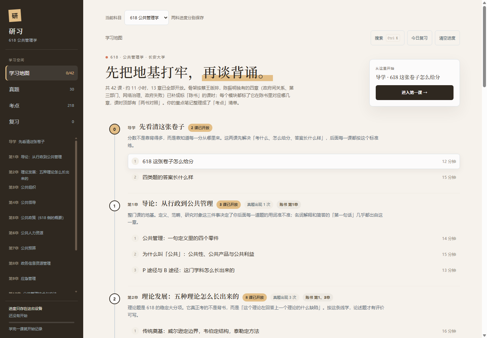
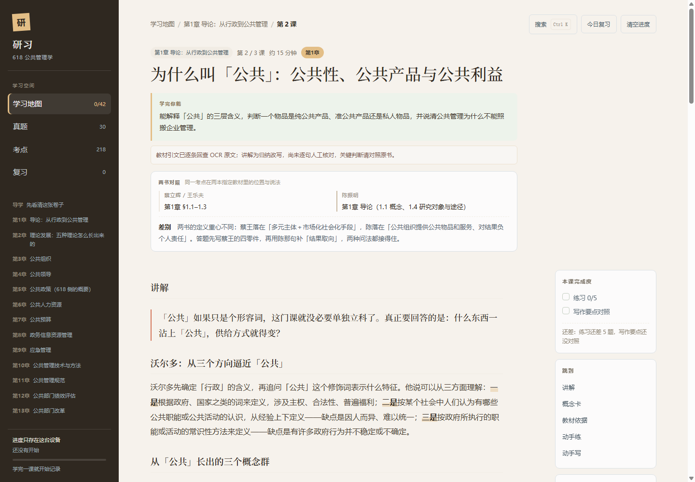
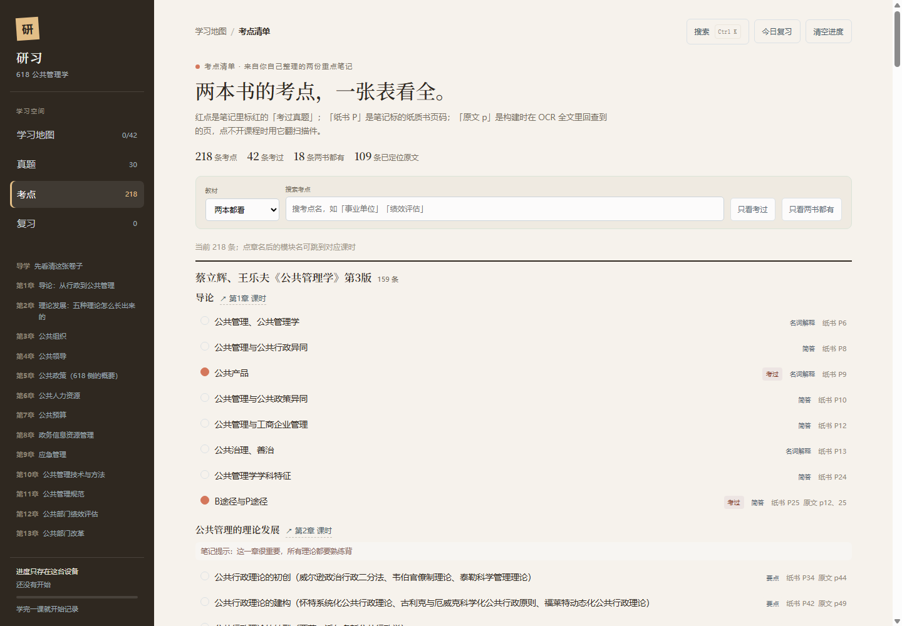
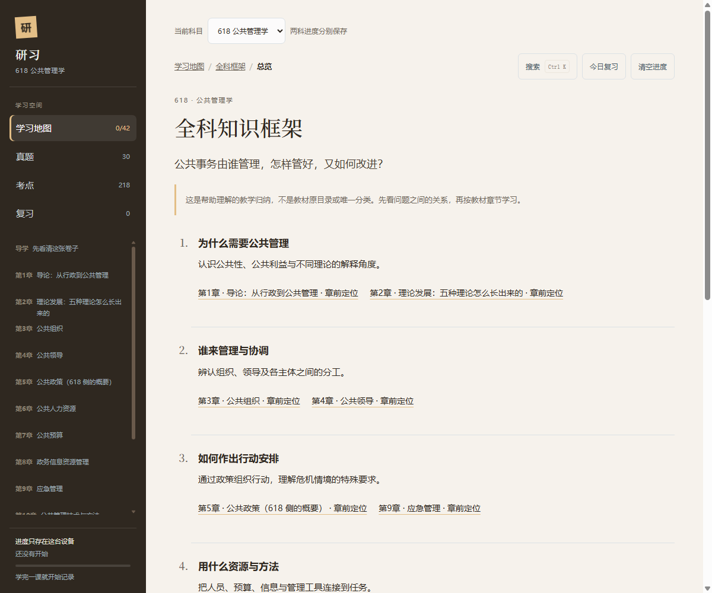
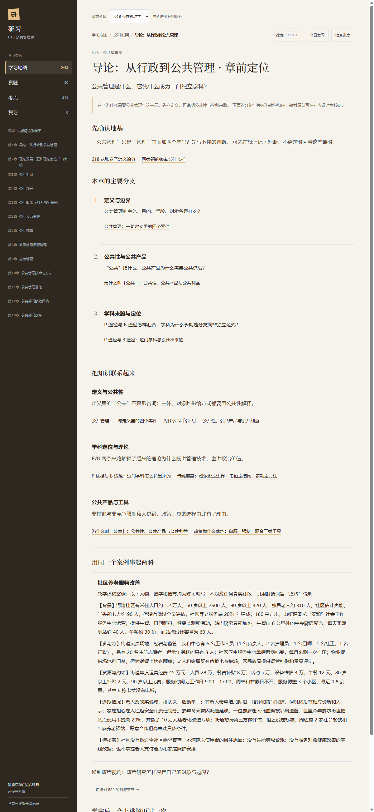

# 研习 · 618 / 822 公共管理学习站

一个**离线单页**的考研专业课学习站：公共管理学（618）与公共政策学（822）共用同一个
`index.html`，用 `?subject=822` 切换，进度按科目分开存在浏览器里。

在线预览：**https://yikun-justcai.github.io/yanxi-618-822/**



## 它是什么

不是题卡，也不是把教材搬上网页，而是一条完整的学习路径：

- **学习地图**：618 42 课 / 822 29 课，按教材章节组织，标出两本参考书的对应位置。
- **课时**：讲解、概念卡、两书对照、教材依据（可展开同页前后文）、练习、限时写作。
- **练习**：选择、多选、判断、排序，答错自动进入复习队列。
- **写作**：每课一次限时书写，写完后对照得分点清单自评，再和示范答案比措辞。
- **真题**：618 30 道、822 26 道，带作答提纲、参考答案与教材依据。
- **考点**：618 218 条、822 185 条，来自重点笔记，标出笔记页码、是否考过、教材原文页。
- **复习**：到期课时、错题、写作漏点三类记录。
- **全科框架与闭卷重建**：两科 25 个正课章节，每章先看问题框架与章前定位，学完后闭卷还原结构、
  解释联系、分析同一个社区养老案例，再展开参考逐项自评。

## 快速开始

最简单：下载或克隆后，双击 `index.html`，不需要安装、联网或账号。

```bash
git clone https://github.com/yikun-justcai/yanxi-618-822.git
cd yanxi-618-822
# 双击 index.html，或：
# python -m http.server 8000   # 然后打开 http://localhost:8000
```

也可以直接用 GitHub Pages：<https://yikun-justcai.github.io/yanxi-618-822/>。

## 截图

| 课时 | 考点 |
|---|---|
|  |  |

| 全科框架 | 共享案例 |
|---|---|
|  |  |

## 两科与教材

| 科目 | 主教材 | 对照教材 | 规模 |
|---|---|---|---|
| 618 公共管理学 | 蔡立辉、王乐夫《公共管理学》第3版 | 陈振明《公共管理学》第二版 | 42 课 / 206 练习 / 30 真题 / 218 考点 |
| 822 公共政策学 | 宁骚《公共政策学》第3版 | 谢明《公共政策导论》第5版 | 29 课 / 63 练习 / 26 真题 / 185 考点 |

两科共 71 课、269 道练习、56 道真题、403 条考点、246 条教材依据。

课程讲解是教学归纳，不是教材原文；每条关键判断都尽量挂一条教材短引文。真题参考答案
依据本地教材编写，**不是官方评分标准**。

## 目录

```
index.html                 整个站点（HTML + CSS + JS + 数据）
course/                    课程数据与构建校验
  curriculum.py            618 模块与课时目录
  m*.py, extra.py          618 课时
  policy.py, policy_lessons.py  822 课时
  dual.py                  618 两书对照依据
  framework.py             全科框架、共享案例、m3/p4 示例
  framework_more.py        其余章节的章前定位与闭卷任务
build_site.py              校验并写入 index.html 的数据块
exam_content.py            真题与作答提纲
reference_answers.py       真题参考答案
notes_import.py            重点笔记 docx → 考点 JSON
notes_data.json            618 考点数据
policy_notes_data.json     822 考点数据
ocr_index.py               教材文本索引与引文回查
source_inventory.json      教材来源清单（文本不随仓库分发）
tools/selftest.py          无头 Edge 回归自测
tools/test_mineru.py       MinerU 源与引文迁移测试
specs/                     设计与验收记录
使用说明.md                 中文使用说明与重建步骤
```

## 开发与重建

站点本身不依赖构建：`index.html` 已经包含全部数据。只有修改课程或重建数据时才需要 Python。

```powershell
python build_site.py        # 校验课时、练习、引文、真题来源；重写 index.html 的 JSON 块
python tools/selftest.py    # 两科 165 项浏览器自测（需要本机 Edge/Chrome）
```

**重要**：出于版权考虑，四本教材的完整 OCR / MinerU 文本、扫描 PDF、笔记原文件和
`backups/` **不包含在仓库中**。`build_site.py` 会在 `source_inventory.json` 指向的位置
查找这些文本并逐条回查引文；没有源文本时构建会中止。仓库里的 `index.html` 是可直接运行
的成品，`tools/selftest.py` 也可以直接对它运行。需要完整重建时，请按 `sources/README.md`
放置你自己合法持有的教材文本。

## 数据来源与边界

- 教材文本来自本地扫描件的 MinerU 解析；仓库只保留课程讲解、短引文和页码，不分发教材全文。
- 考点清单由重点笔记 docx 解析生成；红字表示笔记中标记的考过真题，不是对来年命题的预测。
- 笔记页码与教材扫描页序是两套页码，页面分别标注。
- 现有 71 课全部标为 `reviewed`（对照本地 OCR 的人工抽核），但没有声称对整本教材逐页核验；
  自动测试通过也不等于教学效果已被验证。

## 许可与第三方内容

- 站点代码、构建脚本与原创课程讲解：**MIT License**，见 [LICENSE](LICENSE)。
- 教材引文、书名、出版社信息等版权归原作者与出版社所有，仅作学习、评论与教学引用；
  仓库不分发教材全文。若你是权利人并认为某处引用不当，请开 issue 联系。
- 页面中的案例、题目与示范答案均为教学编写；案例明确标注为虚构。

## 贡献

欢迎开 issue 指出引文错误、页码问题、表述不清或交互问题。提交改动前请运行：

```powershell
python build_site.py
python tools/selftest.py
```

新增课时或章节时，请同时更新 `course/` 数据、`specs/001-novice-exam-learning/coverage.md`
的抽核记录，并保证构建与自测通过。
